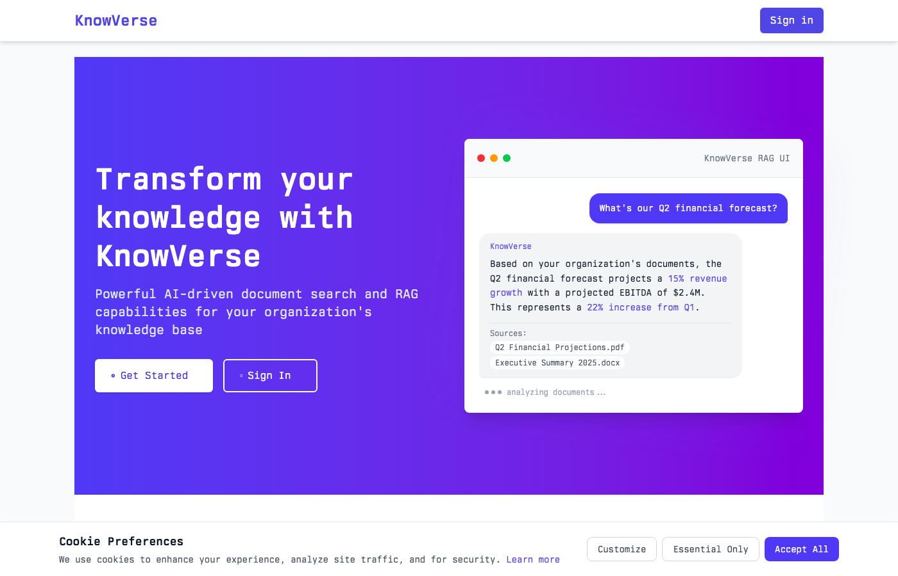

# KnowVerse

**AI-powered knowledge management platform with semantic search, RAG, and MCP integration.**



---

## Why KnowVerse?

Most document search tools force you to remember exact keywords. KnowVerse understands what you mean.

- **Ask questions in plain English** - "What was our Q2 revenue?" instead of hunting through files
- **Get answers with citations** - Every response links back to the exact source chunks
- **Connect your existing tools** - Google Drive, Notion, or direct uploads
- **Use with Claude Desktop** - Native MCP server integration for AI assistants
- **Keep data isolated** - Multi-tenant architecture with organization-level separation

Built for teams who need to find information fast and trust the answers they get.

---

## Features

### Core Capabilities

| Feature | Description |
|---------|-------------|
| **Semantic Search** | Find documents by meaning, not just keywords. Powered by sentence embeddings. |
| **Hybrid Search** | Combines semantic and keyword search using Reciprocal Rank Fusion for best results. |
| **RAG Chat** | Ask questions and get AI-generated answers grounded in your documents. Streaming responses. |
| **Chunk-Level Citations** | Every answer includes clickable citations to the exact source passages. |
| **Cross-Encoder Reranking** | Optional second-stage reranking for improved relevance on complex queries. |

### Integrations

| Feature | Description |
|---------|-------------|
| **MCP Server** | Connect Claude Desktop directly to your knowledge base via Model Context Protocol. |
| **Google Drive** | Sync documents from Google Drive with automatic updates. |
| **Notion** | Import pages and databases from Notion workspaces. |
| **GitHub** | Sync README and markdown files from repositories. |
| **Slack** | Import channel messages and discussions for searchable knowledge. |
| **Confluence** | Sync pages from Atlassian Confluence spaces. |

### Enterprise

| Feature | Description |
|---------|-------------|
| **SSO/SAML** | Single sign-on with SAML 2.0 and OpenID Connect support. |
| **Multi-Tenancy** | Organization-based data isolation with role-based access control. |
| **API Access** | RESTful API with per-organization API keys. |
| **Stripe Billing** | Subscription management with usage-based quotas and Stripe integration. |

### Billing & Quotas

| Plan | Price | Documents | Queries/mo | Team Members |
|------|-------|-----------|------------|--------------|
| Free | $0 | 50 | 500 | 3 |
| Starter | $49/mo | 500 | 2,500 | 10 |
| Growth | $149/mo | 2,500 | 15,000 | 25 |
| Business | $399/mo | 10,000 | 50,000 | 100 |
| Enterprise | Custom | Unlimited | Custom | Unlimited |

### Visualization

| Feature | Description |
|---------|-------------|
| **3D Vector Space** | Interactive visualization of document embeddings with t-SNE/UMAP projections. |
| **Document Clustering** | Group similar documents using K-Means, Hierarchical, or DBSCAN algorithms. |

---

## Architecture

```
Rails 8 (Web/API)  ─────┬───── PostgreSQL (Metadata + pgvector)
      │                 │
      │                 ├───── Qdrant (Vector Search)
      │                 │
      └─── Haystack ────┴───── Embeddings, Extraction, RAG
           (Python)
```

---

## Quick Start

### Prerequisites

- Ruby 3.2+
- Python 3.11+
- PostgreSQL 14+ with pgvector
- Redis 7+
- Docker (optional, for Qdrant)

### Development Setup

```bash
# Clone and install
git clone https://github.com/noah-ing/knowverse.git
cd knowverse

# Install dependencies
bundle install
pip install -r services/haystack/requirements.txt

# Database setup
bin/rails db:setup

# Start services
docker compose up -d qdrant redis
bin/rails server

# In another terminal
cd services/haystack && uvicorn app.main:app --reload
```

### Docker (Full Stack)

```bash
docker compose up -d
```

---

## Configuration

Create a `.env` file:

```env
DATABASE_URL=postgres://localhost/knowverse_development
REDIS_URL=redis://localhost:6379
QDRANT_URL=http://localhost:6333
HAYSTACK_SERVICE_URL=http://localhost:8000

# AI providers (at least one required for RAG)
OPENAI_API_KEY=sk-...
ANTHROPIC_API_KEY=sk-ant-...

# Connectors (optional - for third-party integrations)
GOOGLE_CLIENT_ID=...
GOOGLE_CLIENT_SECRET=...
NOTION_CLIENT_ID=...
NOTION_CLIENT_SECRET=...
GITHUB_CLIENT_ID=...
GITHUB_CLIENT_SECRET=...
SLACK_CLIENT_ID=...
SLACK_CLIENT_SECRET=...
CONFLUENCE_CLIENT_ID=...
CONFLUENCE_CLIENT_SECRET=...
```

---

## MCP Integration

Connect Claude Desktop to your knowledge base:

```json
{
  "mcpServers": {
    "knowverse": {
      "url": "https://your-instance.com/mcp",
      "headers": {
        "X-MCP-Key": "<YOUR_API_KEY>"
      }
    }
  }
}
```

Generate your API key from Organization Settings.

---

## API Reference

### Documents

| Method | Endpoint | Description |
|--------|----------|-------------|
| POST | `/api/v1/documents` | Upload document |
| GET | `/api/v1/organizations/:id/documents` | List documents |
| DELETE | `/api/v1/documents/:id` | Delete document |

### Search

| Method | Endpoint | Description |
|--------|----------|-------------|
| POST | `/api/v1/search` | Semantic/hybrid search |
| GET | `/search` | Web search interface |

### RAG

| Method | Endpoint | Description |
|--------|----------|-------------|
| POST | `/rag/query` | Single question/answer |
| POST | `/rag/stream` | Streaming response (SSE) |

Full API documentation available at `/docs/api`.

---

## Technology Stack

| Layer | Technology |
|-------|------------|
| **Backend** | Rails 8, Ruby 3.2 |
| **Database** | PostgreSQL 14+ with pgvector |
| **Vector Store** | Qdrant (HNSW indexing) |
| **ML Services** | Python 3.11, Haystack 2.0, FastAPI |
| **Embeddings** | SentenceTransformers (all-mpnet-base-v2) |
| **LLMs** | OpenAI GPT-4o, Anthropic Claude |
| **Frontend** | Hotwire (Turbo + Stimulus), Tailwind CSS |
| **Background Jobs** | Solid Queue |
| **Caching** | Solid Cache + Redis |

---

## Testing

```bash
# Rails tests
bundle exec rspec

# Python tests
cd services/haystack && pytest

# Linting
bundle exec rubocop
```

---

## License

Copyright 2024-2025 Noah Ingwers. All rights reserved.

This software is proprietary and confidential. Unauthorized copying, distribution, or use of this software is strictly prohibited.

For licensing inquiries, contact: noah.ing@protonmail.com
